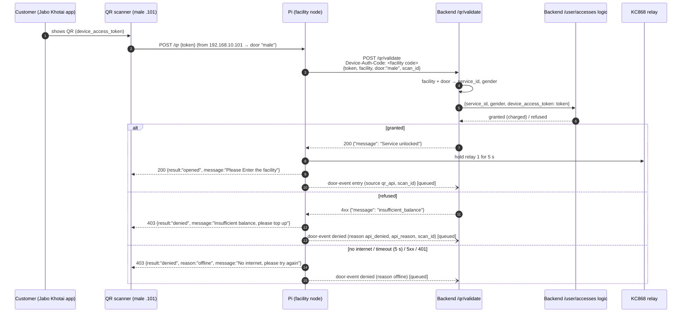
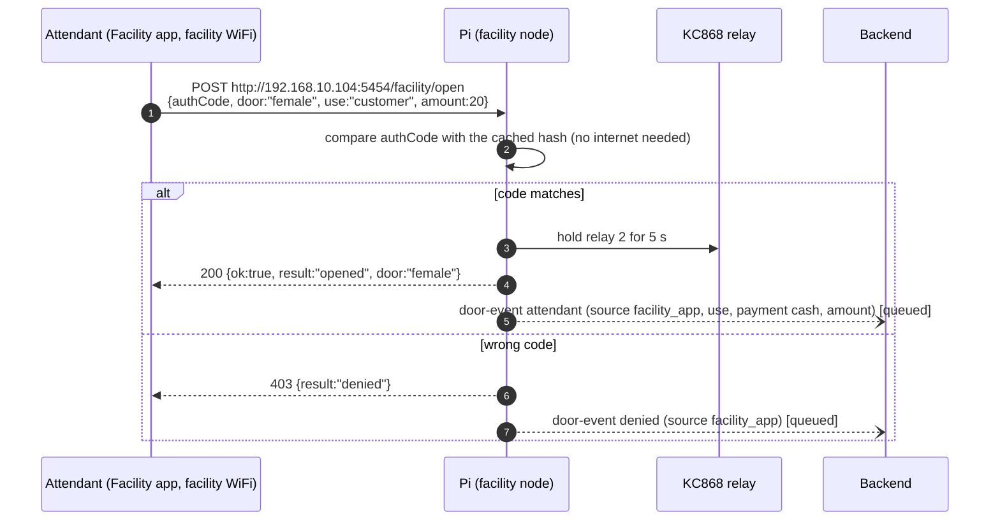
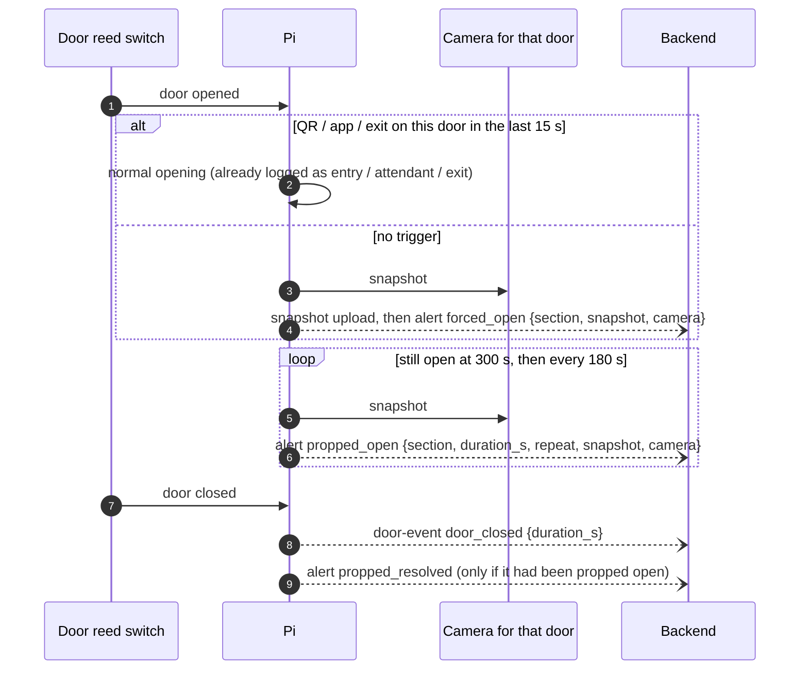
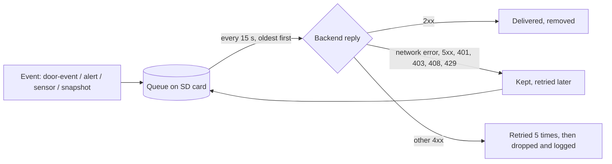

# Facility node: API flow

How every request moves between the apps, the Raspberry Pi (facility node) and the backend. Written for the backend and app developers. The exact field-by-field contract is [README.md](README.md) sections 7 and 8; this document shows **who calls whom, when, and what happens on each answer**.

## Contents

1. [Who talks to whom](#1-who-talks-to-whom)
2. [Customer entry: Jabo Khotai QR](#2-customer-entry-jabo-khotai-qr)
3. [Staff entry: Facility app](#3-staff-entry-facility-app)
4. [Exit button](#4-exit-button)
5. [Door watching: forced and propped-open alerts](#5-door-watching-forced-and-propped-open-alerts)
6. [Air quality and camera health](#6-air-quality-and-camera-health)
7. [Settings from the admin panel (pull every 5 min)](#7-settings-from-the-admin-panel-pull-every-5-min)
8. [How the Pi delivers to the backend](#8-how-the-pi-delivers-to-the-backend)
9. [Endpoint summary and status](#9-endpoint-summary-and-status)
10. [Open questions for the backend](#10-open-questions-for-the-backend)

---

## 1. Who talks to whom

```
                         INTERNET                                   FACILITY LAN (192.168.10.0/24)
 ┌───────────────────────────────────────┐        ┌──────────────────────────────────────────────────────┐
 │ Backend  stage-api.bhumijo…/api        │        │  Raspberry Pi 5 — facility node, port 5454           │
 │  • /qr/validate     (QR check+charge) ◄├────────┤  • asks the backend about each customer QR           │
 │  • token pull       (settings)        ◄├────────┤  • pulls settings every 5 min                        │
 │  • sensor / door-event / alert / snap ◄├────────┤  • pushes everything it sees (queued on the SD card) │
 │ Admin panel (office staff)             │        │                                                      │
 └───────────────────────────────────────┘        │   ▲ POST /qr           ▲ POST /facility/open          │
                                                   │   │                    │                              │
 Jabo Khotai app (customer phone)                  │ QR scanners        Facility app (attendant phone,    │
  shows a QR ──────────── scanned at the gate ─────┤ male .101          on the facility WiFi)             │
                                                   │ female .102                                          │
                                                   │                                                      │
                                                   │ Pi ──► KC868 relay board .174 ──► door locks         │
                                                   │ Pi ──► cameras (RTSP)   Pi ◄── air sensor board .105 │
                                                   │ Pi ◄── reed switches (GPIO) on each door             │
                                                   └──────────────────────────────────────────────────────┘
```

Rules that shape every flow:

- **Every call goes Pi → backend.** The backend never calls the Pi (it is behind the router, LAN only).
- **The apps never call the backend to open a door.** The scanner and the Facility app talk to the Pi; the Pi decides and fires the relay.
- **Offline-first.** Everything the Pi records is saved on its SD card first and sent later. Only the customer QR check needs the internet (the backend charges per entry).
- **One door per section.** Doors are named `male` and `female`; that name is the `section` / `gender` in every call.

---

## 2. Customer entry: Jabo Khotai QR

The customer opens the Jabo Khotai app, which shows a QR holding their `device_access_token` (e.g. `BHU-62AB…`). They hold it up to the scanner at the gate.



**Step by step**

1. **Which door.** The Pi picks the door from the scanner's IP (`.101` = male, `.102` = female). A scan from any other IP is refused (`403 unknown_scanner`); nothing opens.
2. **Read the code.** From JSON (`token`, `SCode`, `cardid`, `code`…), a form field, the query string or a plain-text body. Scanners may post to `/qr`, `/api/device/code`, `/qrscanner` or `/rakindaqrscanner`: same logic, each answered in that scanner's format.
3. **Same code again within 10 s** (scanners repeat): treated as the same scan. No second backend call, **no second charge**; an open door just stays open.
4. **The Pi asks the backend:** `POST {ADMIN_URL}/qr/validate`

   ```http
   POST /api/qr/validate
   Device-Auth-Code: <the facility's Auth Code>
   Idempotency-Key: 6f1c…-uuid
   Content-Type: application/json

   {"token": "BHU-62AB420EA75D10.29957199", "facility": "facility-001", "door": "male",
    "scan_id": "6f1c…-uuid"}
   ```

   - `Device-Auth-Code`: one per facility (admin panel → Device List), kept in the Pi's `.env`. It identifies the facility; the admin key is not sent on this call.
   - `token`: exactly what the scanner read (the customer's `device_access_token`).
   - `door`: `male` or `female`.
   - `scan_id` / `Idempotency-Key`: new for every scan.
5. **Inside `/qr/validate` (backend):**
   - find this facility's gate for `door` → its `service_id` and `gender` (set in the admin panel; the Pi doesn't keep them);
   - run the `/user/accesses` logic with `{service_id, gender, device_access_token: token}`: check the balance and charge;
   - **charge each `scan_id` once:** asked again with the same `scan_id` (the Pi's reply got lost), answer the first result without charging again;
   - answer the Pi as below.
6. **The answer decides:**

   | `/qr/validate` reply | Pi does | Scanner shows |
   |---|---|---|
   | **200** `{"message": "Service unlocked"}` | opens the gate (relay held 5 s) | "Please Enter the facility" |
   | **4xx** (400 / 402 / 403 / 404 / 410 / 422) `{"message": "<reason>"}` | stays shut; logs `message` as `api_reason` | "Insufficient balance, please top up" if `message` is `insufficient_balance` (or `insufficient_funds`, `no_balance`, `low_balance`), else "Access denied" |
   | 200 with any other `message` | stays shut | "Access denied" |
   | **401** | stays shut; logs "credentials refused: check DEVICE_AUTH_CODE" (the Pi's code is wrong, not the customer's) | "No internet, please try again" |
   | timeout (5 s), network error, 5xx | stays shut | "No internet, please try again" |

   The text is compared ignoring upper/lower case and outer spaces, so `"Service unlocked"` and `"SERVICE UNLOCKED"` both open; `"Service unlocked."` (with a full stop) would not.
7. **Relay failed after "Service unlocked"** (the customer was charged but the door did not open): the Pi sends a `relay_failed` door-event with the same `scan_id`, so the backend can **refund** it.
8. **Report:** every outcome becomes a door-event (section 8), sent from the queue.

---|---|---|
   | any **2xx** | opens the gate (relay held 5 s) | "Please Enter the facility" |
   | **400 / 402 / 403 / 404 / 410 / 422** | stays shut; logs the reply's `message` as `api_reason` | "Insufficient balance, please top up" if `message` is `insufficient_balance` (or `insufficient_funds`, `no_balance`, `low_balance`), else "Access denied" |
   | **401** | stays shut; logs "credentials refused: check DEVICE_AUTH_CODE" (the Pi's code is wrong, not the customer's) | "No internet, please try again" |
   | timeout (5 s), network error, 5xx | stays shut | "No internet, please try again" |

6. **Relay failed after a 2xx** (the customer was charged but the door did not open): the Pi sends a `relay_failed` door-event with the same `scan_id`, so the backend can **refund** it.
7. **Report:** every outcome becomes a door-event (section 8), sent from the queue.

> **Backend: please refuse with a 4xx.** The Pi treats any 2xx as "granted". A refusal sent as `200 {"granted": false}` would open the gate. If the backend must answer 200 either way, tell us the field name and the Pi will read it instead (`QR_API_ALLOW_FIELD`).

---

## 3. Staff entry: Facility app

The manager app is retired. Attendants open doors with the **Facility app**, which calls the Pi directly over the facility WiFi. It works **with no internet**.



**Request**

```json
POST /facility/open
{"authCode": "<facility auth code>", "door": "female",
 "use": "customer", "amount": 20, "attendant": "rahim"}
```

| Field | Meaning |
|---|---|
| `authCode` | The facility's Auth Code (also accepted as header `X-Auth-Code`) |
| `door` | `male` / `female` (or header `X-Door`) |
| `use` | `customer`: a customer paid cash at the counter (`amount` optional, logged as a cash sale). `personal`: the attendant's own use, with `purpose` = `cleaning` / `bath` / `toilet` / `maintenance` |
| `attendant` | Optional: who pressed it |

**Replies:** `200 opened` · `403 denied` (wrong code) · `400 unknown_door` / `bad_use` / `bad_purpose` / `bad_amount` · `429` after 5 wrong codes from one phone in 60 s (blocked 1 min) · `502 relay_error` (relay board down; a cash sale is reported as `relay_failed` so it can be voided).

**Where the Auth Code comes from:** it is the facility's code from the admin panel's Device List, the same code the Pi sends as `Device-Auth-Code` to `/qr/validate`.

- **Now (no settings pull yet):** the Pi checks it against `DEVICE_AUTH_CODE` in its `.env`.
- **Once the backend sends `authCode`** in the settings pull (section 7): that code wins, and `.env` is no longer used. The Pi keeps only its SHA-256 hash, so it keeps working through an outage. Office staff can then change the code in the admin panel without touching the Pi.
- `facility health` → `auth_code_source` shows which one is in use (`backend`, `env`, or `null` = Facility app refused).

---

## 4. Exit button

The exit button opens the door **in hardware** (through a timer module), even with the Pi off. The Pi only records it: the KC868 reports the press, and the Pi queues a door-event `exit` (source `exit_button`). No API call opens anything.

> On this site the KC868 firmware does not report inputs yet (flash `firmware/kc868/main.py`), so exits are not logged and look like forced openings.

---

## 5. Door watching: forced and propped-open alerts

Each door has a reed switch (needs `REED=1`). The Pi matches every physical opening with what triggered it.



- **Which camera:** the one linked to that door in the admin panel (`cameraDoors`, section 7), else the `.env` link. One camera per door; one camera may cover both doors.
- **Snapshot first:** the image upload is queued before its alert, so the backend has the picture when the alert arrives. The alert's `snapshot` equals the upload's `name`.

---

## 6. Air quality and camera health

Every 60 s the Pi pushes one **sensor** item: air readings from the sensor board plus each camera's health.

```json
POST SENSOR_PATH
{"id": "7f3c…", "facility": "facility-001", "ts": "2026-10-30T10:15:00Z",
 "tvoc": 120, "tvoc_score": 11, "tvoc_level": "very_good", "eco2": 450, "aqi": 2,
 "temperature": 28.4, "humidity": 71.2, "nh3_ppm": null, "h2s_ppm": null,
 "camera":  {"reachable": true, "streaming": true, "frozen": false, "checked_at": "…"},
 "cameras": {"entry": {"reachable": true, "streaming": true, "frozen": false, "checked_at": "…"}}}
```

- `null` = sensor warming up, failed or not fitted.
- **Odour alert:** any metric over its limit for 10 min → alert `odour_high` (repeated every 30 min while high); all back under for 5 min → `odour_resolved`.
- **Camera health:** probed every 30 s (port open, stream decodes, picture not frozen). This feeds the admin panel's Camera Status page (Online/Offline).

---

## 7. Settings from the admin panel (pull every 5 min)

The Pi pulls its settings every 5 minutes (and at start). This is how office staff change things without touching the Pi.

```http
GET TOKENS_PATH?facility=facility-001&mac=2c:cf:67:01:a7:ea
Authorization: Bearer <ADMIN_KEY>
```

```json
{"facilityId": "facility-001",
 "authCode": "<Facility app auth code>",
 "tokens": [{"token": "abc…", "expiresAt": "2026-11-01T00:00:00Z"}],
 "cameraDoors": {"entry": ["male", "female"]}}
```

`mac` is the Pi's MAC address (`DEVICE_MAC` in `.env`, default the eth0 MAC printed by `facility doctor`). The backend can match it with the **MAC** in the admin panel's Device List, to know which registered device is asking (and refuse one that isn't registered for this facility).

| Field | Used for | If missing |
|---|---|---|
| `authCode` | Facility app unlock (section 3); stored as a hash | Previous code kept |
| `tokens` | Offline QR list (older modes, not Jabo Khotai paid entry). **Replaces** the list; `[]` revokes all | — |
| `cameraDoors` | Which camera pictures which door (section 5); key = camera name or IP | `.env` `CAM_<NAME>_DOORS` |

- All of it is **saved on the Pi**, so a reboot during an outage keeps the last settings.
- A failed pull keeps everything as it was.
- Invalid `cameraDoors` (unknown door or camera) is ignored and logged; the Pi falls back to `.env`.
- Gate service ids are **not** in this pull: the backend's `/qr/validate` looks them up itself.
- A reply for a different `facilityId` is ignored.

---

## 8. How the Pi delivers to the backend

Every event is **written to the SD card first**, then sent oldest-first by a background job (every 15 s).



- **Every item has a unique `id`** (UUID), in the body and as the `Idempotency-Key` header. A retry after a lost reply sends the **same id**. The backend must store ids and answer a repeat with 2xx **without saving it twice**.
- `ts` is when it happened (ISO 8601 UTC), not when it was sent: after an outage, events arrive late but with the right time.
- All pushes carry `Authorization: Bearer <ADMIN_KEY>` (header and scheme configurable).

**Door-event types** (`POST DOOR_EVENT_PATH`):

| `type` | When | Extra fields |
|---|---|---|
| `entry` | QR opened the gate | `source` (`qr_api` for Jabo Khotai), `scan_id` |
| `attendant` | Facility app opened it | `use`, `purpose` or `payment: cash` + `amount`, `attendant` |
| `exit` | Exit button pressed | `source: exit_button` |
| `denied` | Refused | `source`, `reason` (`api_denied`, `offline`, `unknown`, `empty`), `api_reason` (the backend's `message`), `scan_id` |
| `relay_failed` | Paid (online or cash) but the door did not open | `scan_id` or the cash-sale fields: **refund / void** |
| `door_closed` | Door shut again | `duration_s` |

**Alert subtypes** (`POST ALERT_PATH`): `forced_open`, `propped_open` (`repeat` false = new, true = update), `propped_resolved`, `odour_high`, `odour_resolved`.

---

## 9. Endpoint summary and status

### Backend endpoints the Pi calls

Paths are set in the Pi's `.env`, so the backend may choose its own; tell us the final ones.

| Call | Default path (`.env` key) | When | Status |
|---|---|---|---|
| QR check + charge | `POST /qr/validate` (`QR_API_URL`) | each customer scan | **To build**: wraps the existing `/user/accesses` (section 2). Pi side ready |
| Settings pull | `GET /facility/tokens` (`TOKENS_PATH`, may be renamed e.g. `/facility/config`) | every 5 min | **To build** (`authCode`, `cameraDoors`) |
| Door-event push | `POST /facility/door-event` (`DOOR_EVENT_PATH`) | each event | **To build** |
| Alert push | `POST /facility/alert` (`ALERT_PATH`) | each anomaly | **To build** |
| Sensor push | `POST /facility/sensor` (`SENSOR_PATH`) | every 60 s | **To build** |
| Snapshot upload | multipart `POST` (`SNAPSHOT_UPLOAD_PATH`) | with each door alert | **To build** (optional; off until set) |

Until an endpoint exists, the Pi keeps its items queued (nothing is lost), up to 200 000; the oldest sensor readings are dropped first.

### Pi endpoints (LAN only, port 5454)

| Call | Caller | Purpose |
|---|---|---|
| `POST /qr`, `POST /api/device/code` | QR scanner | Customer scan (section 2) |
| `GET\|POST /qrscanner`, `POST /rakindaqrscanner` | Other scanner models | Same, in their reply format |
| `POST /facility/open` | Facility app | Staff unlock (section 3) |
| `GET /health` | Ops / `facility health` | Queue, last pull, doors, cameras, QR API state, service ids |

---

## 10. Open questions for the backend

1. **`/qr/validate` replies:** `200 {"message": "Service unlocked"}` to open, exactly that text; every refusal a 4xx with the reason in `message` (e.g. `402 insufficient_balance`, `403 invalid_token`). (Agreed 2026-10-30.)
2. **Idempotency:** store `Idempotency-Key` (= `scan_id`) and answer a repeat with the first result, no second charge. Refund on `relay_failed`.
3. **Facility app Auth Code vs Device Auth Code:** are they the same code? The Facility app's comes in the pull; the Device Auth Code is set in the Pi's `.env`.
4. **Final paths and auth** for the pull and the four pushes, and the auth header they expect (default `Authorization: Bearer <key>`).
5. **`cameraDoors`** in the settings pull, edited from the admin panel (Camera Status); each gate's `service_id` stays in the backend for `/qr/validate`.
